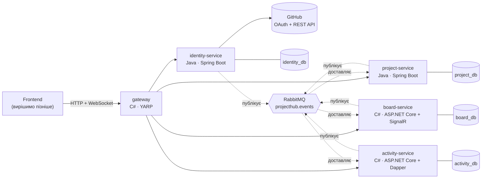
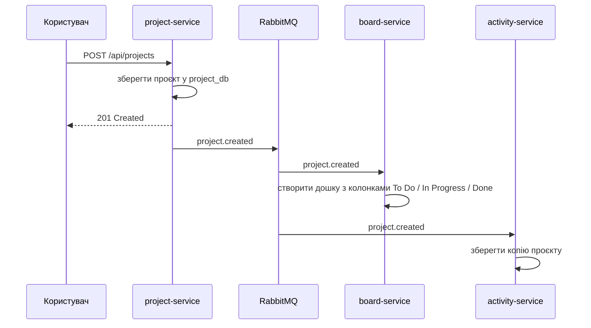
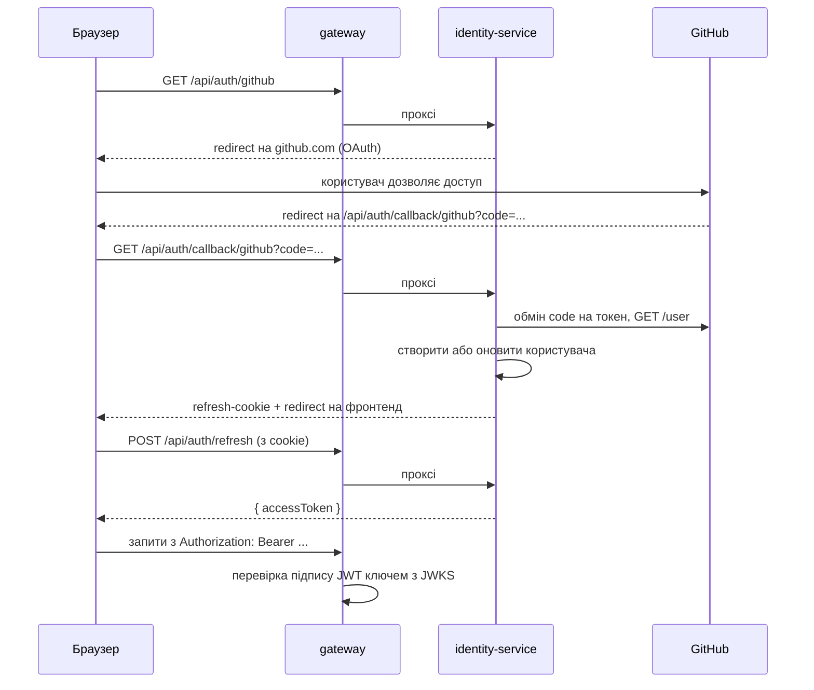

# Архітектура

## 1. Загальна схема

## 2. Чесно про мікросервіси

Для двох людей моноліт був би простішим і швидшим. Мікросервіси обрано свідомо з двох причин: ви пишете на різних мовах, і головна мета проєкту — навчитися. Щоб не потонути в складності:

- лише 4 сервіси + gateway;
- одна PostgreSQL (окрема база на кожен сервіс) і один RabbitMQ;
- жодного Kubernetes, service discovery, Kafka, config server. Адреси сервісів просто лежать у налаштуваннях і Docker Compose.

## 3. Сервіси і чиї дані

Головне правило: **у кожних даних один власник**. Інші сервіси отримують копію через події і ніколи не лізуть у чужу базу.

| Дані | Власник | Хто тримає копію (read model) |
|---|---|---|
| Користувачі, профілі, навички, GitHub-токени, refresh-токени | identity | project, board, activity — тільки логін, ім'я, аватар |
| Заклади, членство в закладах | project | — |
| Проєкти, учасники, ролі «шукаємо», заявки | project | board — учасники для прав доступу; activity — назва і статус |
| Дошки, колонки, картки, коментарі | board | activity — як записи в стрічці |
| Внесок, стрічка подій, остання активність | activity | project — тільки статус ACTIVE / INACTIVE |

## 4. Чому тут C#, а тут Java

Обидві мови вміють усе з цього списку. Розподіл зроблено там, де фреймворк дає найбільше «з коробки», і так, щоб навантаження було рівним.

| Сервіс | Мова | Чому саме вона |
|---|---|---|
| gateway | C# | YARP — reverse proxy від Microsoft: маршрути описуються в `appsettings.json`, а перевірка JWT, CORS і rate limiting — стандартні middleware ASP.NET Core. Невеликий сервіс — гарна перша задача. |
| identity-service | Java | Spring Security має готовий провайдер GitHub для OAuth2-логіну і готовий Resource Server для JWT. Безпека — найсильніша сторона Spring. |
| project-service | Java | Найбагатша доменна модель: заклади, проєкти, учасники, заявки, ліміти, ролі. Spring Data JPA + Bean Validation + `@Transactional` тут почуваються найкраще. |
| board-service | C# | SignalR — найпростіший спосіб зробити дошку «живою»: зміну картки миттєво бачать усі, хто її відкрив. EF Core — для звичайного CRUD. |
| activity-service | C# | Фонові задачі через `BackgroundService`, складні агрегуючі SQL-запити через Dapper. EF Core у board + Dapper в activity — у портфоліо видно обидва підходи до роботи з БД. |

Навантаження: у Java 2 великі сервіси (identity, project), у C# 2 середні + маленький gateway. За кількістю задач виходить приблизно порівну, див. [ROADMAP.md](ROADMAP.md).

## 5. Як сервіси спілкуються

**Синхронно (REST)** — тільки клієнт → gateway → сервіс. Між собою сервіси по REST майже не ходять: усе, що сервісу треба знати про чужі дані, він бере з подій. Єдиний виняток — сервіси читають публічний ключ identity (JWKS), щоб перевіряти JWT.

**Асинхронно (RabbitMQ)** — сервіс змінив свої дані → публікує подію → зацікавлені сервіси оновлюють свої копії. Формат і список подій — [EVENTS.md](EVENTS.md).

Наслідок, з яким треба змиритися: **eventual consistency**. Дошка з'явиться не в ту саму мілісекунду, що й проєкт, а через частку секунди. Фронтенд має це враховувати: показати «дошка створюється…» і повторити запит.

## 6. Автентифікація

Деталі:

- **Access-токен** — JWT, підпис **RS256**, живе **15 хвилин**. Claims: `sub` (UUID користувача), `login` (GitHub-логін), `iss`, `aud` = `projecthub`, `exp`, `iat`. У заголовку токена обов'язково `kid`.
- **Refresh-токен** — випадковий рядок у cookie `HttpOnly; SameSite=Lax; Path=/api/auth`, живе 30 днів. У БД зберігається тільки його хеш. При кожному оновленні старий відкликається і видається новий (rotation).
- identity віддає `/.well-known/openid-configuration` і `/.well-known/jwks.json`. Інші сервіси беруть звідти публічний ключ:
  - .NET: `AddJwtBearer` з `MetadataAddress`;
  - Spring: `spring.security.oauth2.resourceserver.jwt.jwk-set-uri`.
- JWT перевіряють **і gateway, і кожен сервіс**. Gateway — щоб відсікти сміття раніше, сервіси — бо мережі довіряти не можна.
- Ролі в закладах і проєктах у JWT **не кладемо**: вони змінюються частіше, ніж живе токен. Кожен сервіс перевіряє права за своїми даними.
- **Паралельна робота до готовності identity:** C#-розробник генерує тестові токени через `dotnet user-jwts`. Коли буде готова задача JV-03, з'явиться `POST /api/dev/token` (працює тільки в профілі `dev`).

Підводний камінь: OAuth-колбек іде через gateway, тому identity має бачити зовнішню адресу, а не свою внутрішню. У Spring для цього `server.forward-headers-strategy=framework`, а YARP за замовчуванням додає заголовки `X-Forwarded-*`.

## 7. Авторизація: хто що може

| Дія | Хто |
|---|---|
| Переглядати проєкт, дошку, портфоліо | будь-який залогінений користувач |
| Створити проєкт у закладі | підтверджений учасник закладу, ліміт 3 власних |
| Редагувати й архівувати проєкт, схвалювати заявки, керувати ролями «шукаємо» | OWNER проєкту |
| Подати заявку в проєкт | будь-хто, ліміт 5 приєднань |
| Створювати й рухати картки, коментувати | OWNER і MEMBER проєкту |
| Видалити чужий коментар | OWNER проєкту |
| Схвалювати заявки до закладу | TEACHER або ADMIN закладу |

## 8. Realtime на дошці

- SignalR-хаб у board-service: `/hubs/board`.
- Клієнт викликає `JoinBoard(boardId)` → сервер перевіряє доступ і додає з'єднання до групи `board:{boardId}`.
- Зміни робляться **через REST**, а хаб лише сповіщає. Після успішної зміни сервіс через `IHubContext` розсилає групі: `CardCreated`, `CardUpdated`, `CardMoved`, `CardDeleted`, `ColumnsChanged`, `CommentAdded`. Так бізнес-логіка живе в одному місці і її легко тестувати.
- Браузер не може передати заголовок `Authorization` у WebSocket, тому токен іде в `?access_token=`. Це стандартний прийом SignalR (`JwtBearerEvents.OnMessageReceived`).

## 9. Спільні правила для обох мов

- **Помилки** — формат ProblemDetails (RFC 9457): `ProblemDetail` у Spring, `AddProblemDetails()` / `Results.Problem` в ASP.NET Core. Клієнт отримує однакову форму помилки від усіх сервісів.
- **JSON** — `camelCase`. Дати — UTC у форматі ISO-8601 (`2026-11-05T21:00:00Z`). Ідентифікатори — UUID рядком. Enum — рядок `UPPER_SNAKE_CASE`.
- **Пагінація** — `?page=0&size=20` → `{ "items": [...], "page": 0, "size": 20, "total": 134 }`. У Spring не віддавайте `Page<T>` напряму, зробіть свій DTO, щоб формат збігався з C#.
- **Health** — кожен сервіс відповідає на `GET /health`. У Spring: `management.endpoints.web.base-path=/`.
- **Correlation ID** — gateway додає `X-Correlation-Id`, сервіси пишуть його в кожен рядок логу і кладуть у конверт події.
- **OpenAPI** — кожен сервіс описує своє API: springdoc у Java, `Microsoft.AspNetCore.OpenApi` у .NET.

## 10. Рішення і їхні причини

| # | Рішення | Чому |
|---|---|---|
| 1 | Монорепозиторій | Двом людям простіше: один PR може змінити контракт і обидві сторони, одна дошка задач |
| 2 | PostgreSQL, окрема база на сервіс | Ізоляція даних як у справжніх мікросервісах, але одна інсталяція |
| 3 | RabbitMQ, а не Kafka | Простіше підняти й зрозуміти. Для нашого обсягу Kafka — надмір |
| 4 | Голий `RabbitMQ.Client` у .NET замість MassTransit | MassTransit за замовчуванням загортає повідомлення у свій формат, і Java його не розбере без додаткових налаштувань. Голий клієнт + наш конверт = однаково в обох мовах |
| 5 | Пошук на PostgreSQL full-text | Окремий Elasticsearch не потрібен: на тисячі проєктів вистачить із запасом |
| 6 | Зміни дошки через REST, SignalR тільки сповіщає | Одна точка бізнес-логіки, простіше тестувати |
| 7 | Ролі не в JWT | Ролі змінюються частіше, ніж живе токен |
| 8 | Код, коміти й назви англійською, документація українською | Код у портфоліо читатимуть роботодавці, документацію — ви |

## 11. Після MVP (Фаза 2)

- **Transactional Outbox** — подія гарантовано відправляється разом із комітом у БД. Зараз між комітом і публікацією подію можна втратити.
- **Синхронізація дошки з GitHub Issues** — картка на сайті = issue на GitHub.
- **Кабінет викладача** — завдання для груп і статистика внеску по командах.
- **OpenTelemetry** — трасування одного запиту через усі сервіси.
- **Деплой** і фронтенд.
